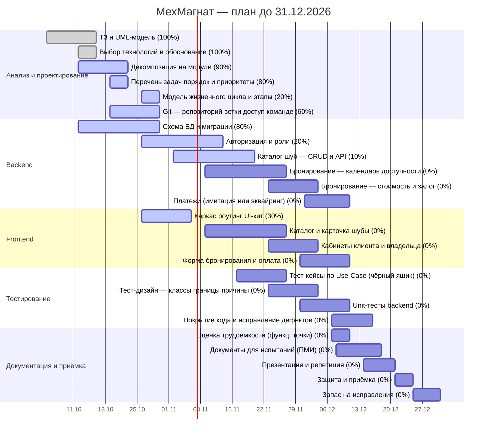

# МехМагнат — Task Tracker

Срок сдачи проекта: **31.12.2026** · Общая готовность: **22%** · Состояние на 23.10.2026

## Диаграмма Ганта

## Доска (Kanban)

### Не начато
- [ ] **#10** Бронирование: календарь доступности — `░░░░░░░░░░` 0% · до 27.11 · приоритет: Высокий
- [ ] **#11** Бронирование: стоимость и залог — `░░░░░░░░░░` 0% · до 04.12 · приоритет: Высокий
- [ ] **#12** Платежи (имитация или эквайринг) — `░░░░░░░░░░` 0% · до 11.12 · приоритет: Средний
- [ ] **#14** Каталог и карточка шубы — `░░░░░░░░░░` 0% · до 27.11 · приоритет: Высокий
- [ ] **#15** Кабинеты клиента и владельца — `░░░░░░░░░░` 0% · до 04.12 · приоритет: Средний
- [ ] **#16** Форма бронирования и оплата — `░░░░░░░░░░` 0% · до 11.12 · приоритет: Высокий
- [ ] **#17** Тест-кейсы по Use-Case (чёрный ящик) — `░░░░░░░░░░` 0% · до 27.11 · приоритет: Высокий
- [ ] **#18** Тест-дизайн: классы, границы, причины — `░░░░░░░░░░` 0% · до 04.12 · приоритет: Высокий
- [ ] **#19** Unit-тесты backend — `░░░░░░░░░░` 0% · до 11.12 · приоритет: Высокий
- [ ] **#20** Покрытие кода и исправление дефектов — `░░░░░░░░░░` 0% · до 16.12 · приоритет: Высокий
- [ ] **#21** Оценка трудоёмкости (функц. точки) — `░░░░░░░░░░` 0% · до 11.12 · приоритет: Средний
- [ ] **#22** Документы для испытаний (ПМИ) — `░░░░░░░░░░` 0% · до 18.12 · приоритет: Высокий
- [ ] **#23** Презентация и репетиция — `░░░░░░░░░░` 0% · до 21.12 · приоритет: Высокий
- [ ] **#24** Защита и приёмка — `░░░░░░░░░░` 0% · до 25.12 · приоритет: Высокий
- [ ] **#25** Запас на исправления — `░░░░░░░░░░` 0% · до 31.12 · приоритет: Высокий

### В работе
- [ ] **#3** Декомпозиция на модули — `█████████░` 90% · до 23.10 · приоритет: Высокий
- [ ] **#4** Перечень задач, порядок и приоритеты — `████████░░` 80% · до 23.10 · приоритет: Высокий
- [ ] **#5** Модель жизненного цикла и этапы — `██░░░░░░░░` 20% · до 30.10 · приоритет: Высокий
- [ ] **#6** Git: репозиторий, ветки, доступ команде — `██████░░░░` 60% · до 30.10 · приоритет: Высокий
- [ ] **#7** Схема БД и миграции — `████████░░` 80% · до 30.10 · приоритет: Высокий
- [ ] **#8** Авторизация и роли — `██░░░░░░░░` 20% · до 13.11 · приоритет: Высокий
- [ ] **#9** Каталог шуб: CRUD и API — `█░░░░░░░░░` 10% · до 20.11 · приоритет: Высокий
- [ ] **#13** Каркас, роутинг, UI-кит — `███░░░░░░░` 30% · до 06.11 · приоритет: Высокий

### Готово
- [x] **#1** ТЗ и UML-модель — `██████████` 100% · до 16.10 · приоритет: Высокий
- [x] **#2** Выбор технологий и обоснование — `██████████` 100% · до 16.10 · приоритет: Высокий

## Таблица задач

| № | Группа | Задача | Начало | Срок | Приоритет | Готовность |
|---|---|---|---|---|---|---|
| 1 | Анализ и проектирование | ТЗ и UML-модель | 2026-10-05 | 2026-10-16 | Высокий | `██████████` 100% |
| 2 | Анализ и проектирование | Выбор технологий и обоснование | 2026-10-12 | 2026-10-16 | Высокий | `██████████` 100% |
| 3 | Анализ и проектирование | Декомпозиция на модули | 2026-10-12 | 2026-10-23 | Высокий | `█████████░` 90% |
| 4 | Анализ и проектирование | Перечень задач, порядок и приоритеты | 2026-10-19 | 2026-10-23 | Высокий | `████████░░` 80% |
| 5 | Анализ и проектирование | Модель жизненного цикла и этапы | 2026-10-26 | 2026-10-30 | Высокий | `██░░░░░░░░` 20% |
| 6 | Анализ и проектирование | Git: репозиторий, ветки, доступ команде | 2026-10-19 | 2026-10-30 | Высокий | `██████░░░░` 60% |
| 7 | Backend | Схема БД и миграции | 2026-10-12 | 2026-10-30 | Высокий | `████████░░` 80% |
| 8 | Backend | Авторизация и роли | 2026-10-26 | 2026-11-13 | Высокий | `██░░░░░░░░` 20% |
| 9 | Backend | Каталог шуб: CRUD и API | 2026-11-02 | 2026-11-20 | Высокий | `█░░░░░░░░░` 10% |
| 10 | Backend | Бронирование: календарь доступности | 2026-11-09 | 2026-11-27 | Высокий | `░░░░░░░░░░` 0% |
| 11 | Backend | Бронирование: стоимость и залог | 2026-11-23 | 2026-12-04 | Высокий | `░░░░░░░░░░` 0% |
| 12 | Backend | Платежи (имитация или эквайринг) | 2026-12-01 | 2026-12-11 | Средний | `░░░░░░░░░░` 0% |
| 13 | Frontend | Каркас, роутинг, UI-кит | 2026-10-26 | 2026-11-06 | Высокий | `███░░░░░░░` 30% |
| 14 | Frontend | Каталог и карточка шубы | 2026-11-09 | 2026-11-27 | Высокий | `░░░░░░░░░░` 0% |
| 15 | Frontend | Кабинеты клиента и владельца | 2026-11-23 | 2026-12-04 | Средний | `░░░░░░░░░░` 0% |
| 16 | Frontend | Форма бронирования и оплата | 2026-11-30 | 2026-12-11 | Высокий | `░░░░░░░░░░` 0% |
| 17 | Тестирование | Тест-кейсы по Use-Case (чёрный ящик) | 2026-11-16 | 2026-11-27 | Высокий | `░░░░░░░░░░` 0% |
| 18 | Тестирование | Тест-дизайн: классы, границы, причины | 2026-11-23 | 2026-12-04 | Высокий | `░░░░░░░░░░` 0% |
| 19 | Тестирование | Unit-тесты backend | 2026-11-30 | 2026-12-11 | Высокий | `░░░░░░░░░░` 0% |
| 20 | Тестирование | Покрытие кода и исправление дефектов | 2026-12-07 | 2026-12-16 | Высокий | `░░░░░░░░░░` 0% |
| 21 | Документация и приёмка | Оценка трудоёмкости (функц. точки) | 2026-12-07 | 2026-12-11 | Средний | `░░░░░░░░░░` 0% |
| 22 | Документация и приёмка | Документы для испытаний (ПМИ) | 2026-12-08 | 2026-12-18 | Высокий | `░░░░░░░░░░` 0% |
| 23 | Документация и приёмка | Презентация и репетиция | 2026-12-14 | 2026-12-21 | Высокий | `░░░░░░░░░░` 0% |
| 24 | Документация и приёмка | Защита и приёмка | 2026-12-21 | 2026-12-25 | Высокий | `░░░░░░░░░░` 0% |
| 25 | Документация и приёмка | Запас на исправления | 2026-12-25 | 2026-12-31 | Высокий | `░░░░░░░░░░` 0% |
